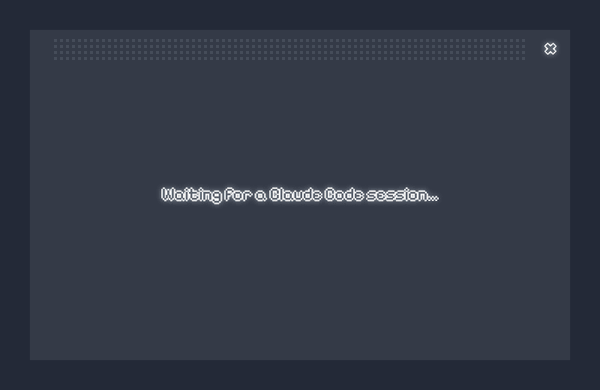
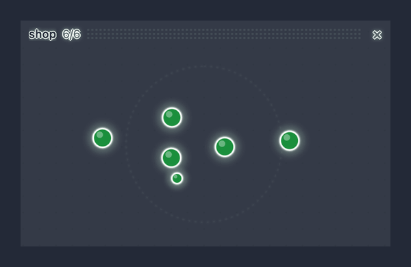

# FlowCTL

A live graph of what Claude Code is doing and what comes next, in a small
floating window on your Mac.



## Why

A long Claude Code session is a wall of text. To know where it stands (what
it is doing now, what is left, whether it is stuck waiting for you) you have
to scroll back and read. With a few sessions open in different terminals, you
end up checking each one in turn.

FlowCTL draws the session instead. The agent's plan becomes a graph: one node
per step, arrows for what depends on what, colors for where each step is. It
floats above your other windows, so a glance tells you how the work is going
and whether a session needs you, without leaving what you are doing.

| Color  | Meaning                                         |
| ------ | ----------------------------------------------- |
| white  | pending                                         |
| blue   | in progress                                     |
| yellow | needs you: a permission prompt or a question    |
| red    | failing: a tool error flashes it, repeated ones keep it red |
| green  | done                                            |

## What you get

- **The plan as a graph.** Steps the agent declares (Claude Code's task tools,
  or FlowCTL's own FlowPlan tool) with their dependencies. Steps that run in
  parallel sit side by side; each new request continues the graph to the right.
- **Subagents** hang from the step that started them, or line up as their own
  timeline when the agent uses them without a plan.
- **Yellow means you.** A permission prompt or a question turns its step
  yellow, the menu bar icon blinks, and a short sound plays.
- **The camera follows the work** while a session runs, and shows the whole
  graph when it rests. Drag to pan, pinch or scroll to zoom.
- **Hover a node** for what it is about, how long it took, and what came of it.
  Click it to bring its terminal tab forward.
- **Every session in one place.** Each open session gets a page and `‹ 1/3 ›`
  switches between them. When the page on screen is resting, the window turns
  to the session that starts working or needs you.
- **Two looks:** pixel art (with 8-bit sounds) or smooth (with clean tones).
- **An idle animation.** After a minute with nothing running, the nodes form a
  shape that turns slowly; after five, the window fades out until a session
  works again.



## Install

Requirements: macOS 13 or later and Claude Code 2.1.295 or later. FlowCTL has
two parts, both installed from a Claude Code session:

```
/plugin install flowctl --marketplace MarcoFilho1/FlowCTL
/flowctl init
```

1. **The plugin.** The first line adds this repository as a plugin
   marketplace (answer `y`), then installs the plugin. Choose the **user**
   scope so it works in every project. The plugin watches the session and
   builds the graph.
2. **The overlay app.** `/flowctl init` downloads the app of the same version
   from this repository's GitHub Releases, checks its SHA-256 and signature,
   installs it in `~/Applications` (no admin password) and opens it. The app is
   the floating window and the menu bar icon.

## Day to day

**You install once.** You do not run either command again when you open a new
session:

- Every Claude Code session you start loads the plugin by itself.
- When a session starts, the plugin opens the overlay if it is not already
  running. Several sessions share one window, one page each.
- The window shows itself when a session starts working and fades out after
  five minutes with nothing running. Close it with **×** and it stays closed
  until you reopen it from the menu bar icon.

**Sessions that were already open** when you installed the plugin: run
`/reload-plugins` in each to load it. The instruction that asks the agent to
declare a plan reaches it from the next session, so restart those sessions
with `claude --continue` to keep their conversation and get the plan too.

**When does the graph have more than one node?** When the agent declares a
plan. FlowCTL asks it to, for work of three or more steps; a quick question or
a one-command fix shows a single node for the current turn. You can turn that
request off in the plugin's options.

**Updating.** When a new version is out, update the plugin from `/plugin`
(or `claude plugin update flowctl@flowctl`), run `/reload-plugins`, and the
next session start tells you if the app is older than the plugin: run
`/flowctl init` again to update it.

## Commands and options

| Command | What it does |
| ------- | ------------ |
| `/flowctl init` | Installs or updates the overlay app to the plugin's version; opens it if it is already there |
| `/flowctl init --force` | Installs it again |
| `/flowctl init --from-source` | Builds it from the tagged source instead of downloading (needs pnpm, Node 22 and Swift) |
| `/flowctl uninstall` | Quits and removes the app (the plugin is removed from `/plugin`) |

The **menu bar icon** holds the overlay's settings: show or hide the panel,
opacity, size (small, medium, large), look (pixel or smooth), theme (auto,
dark, light), sound, show subagents, idle animation, always on top, show
automatically, hide when idle.

The **plugin's options** (`/plugin`, then flowctl):

| Option | Default | |
| ------ | ------- | - |
| Open the overlay | on | Open the app when a session starts, if it is installed |
| Ask the agent to declare its plan | on | Without it, the graph is usually one node |
| Errors before red | 3 | Consecutive tool errors that turn the current step red |
| Record events | off | Keep the session's events in `~/.flowctl/recordings`, for bug reports |

## Privacy

Everything stays on your Mac. The plugin hands the app each graph over a local
socket (`~/.flowctl/overlay.sock`) and keeps the latest one per session in
`~/.flowctl/sessions`. A graph holds step titles, statuses and times, a short
summary of what a step or subagent answered, and the first line of a tool
error; never your prompts, file contents or full command output. Nothing is
sent anywhere: the only network call is `/flowctl init` downloading the app
from GitHub.

## How it works

```
Claude Code session ──hooks──▶ plugin (mod/) ──snapshot──▶ overlay app (apps/overlay)
  tasks, subagents,             builds the graph,           a floating window drawing
  permission prompts            lays it out                 the graph (apps/viewer)
```

The plugin is a [Claude Code mod](https://code.claude.com/docs/en/plugins/mods/overview):
it observes the session's events (task tools, subagents, permission checks,
tool errors) and never changes what the agent does, apart from the optional
request to declare a plan. The app is a native macOS panel hosting a small web
view; the graph is drawn by the viewer, a React page bundled into the app.

## Roadmap

- **Linux and Windows.** The plugin and the viewer already run anywhere; the
  overlay window is macOS only for now. A cross-platform app is next.
- Your ideas: open an issue.

## Develop

```
mod/             the Claude Code plugin
  hooks/         hooks module: register.ts
  graph/         graph logic, pure TypeScript with no imports
  live/          what the plugin shows and does: status line, rebuild, /flowctl
  tests/         plugin tests, run by `claude plugin test`
  types-vendor/  Claude Code's API types, versioned for CI
apps/viewer/     the graph, a React page (Vite, single file)
apps/overlay/    the macOS app (SwiftPM, no Xcode needed)
tests/           unit tests for mod/, run by node --test
fixtures/        recorded sessions, replayed by the tests and the viewer
scripts/         install-overlay.sh builds and installs the app from source
docs/            roadmap, design notes and the README's media
```

Requires Node 22.6+, pnpm, Claude Code 2.1.295+ and, for the app, Swift (the
Command Line Tools are enough).

```sh
pnpm install
pnpm typecheck   # tsc over the plugin and the tests
pnpm test        # unit tests
pnpm validate    # claude plugin validate + claude plugin test
pnpm viewer:test # viewer tests

claude --plugin-dir ./mod              # a session with the plugin from this folder, hot-reloaded
pnpm viewer:dev                        # the viewer in a browser; ?fixture=all replays the recordings
scripts/install-overlay.sh --open      # build the app and install it
```

Don't run `--plugin-dir` alongside an installed copy of the plugin: the
session would load it twice.

**Releasing.** Set the same version in `mod/.claude-plugin/plugin.json`,
`MOD_VERSION` in `mod/live/install.ts` and `apps/overlay/Resources/Info.plist`,
then push a tag `vX.Y.Z`. The Release workflow builds the app for Apple
silicon and Intel and publishes `FlowCTL-X.Y.Z-macos.zip` and its SHA-256,
which `/flowctl init` downloads. To try a build before tagging, serve a zip
and its `.sha256` under `<base>/vX.Y.Z/` and start the session with
`FLOWCTL_RELEASE_BASE=<base>`.

After a Claude Code upgrade, refresh `mod/types-vendor/claude-code.d.ts` from
`mod/.claude-plugin/types/claude-code/index.d.ts` (written each time a session
loads the mod) and bump `CLAUDE_CODE_VERSION` in CI.
