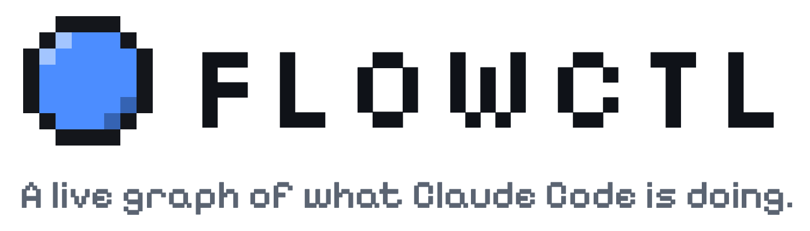
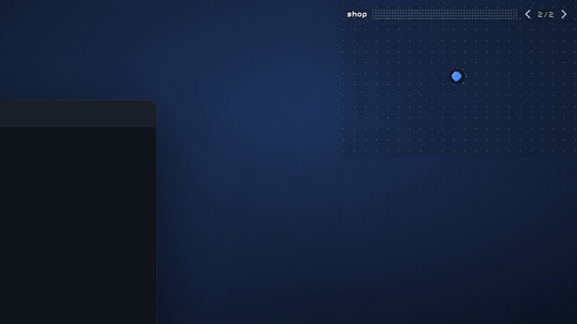
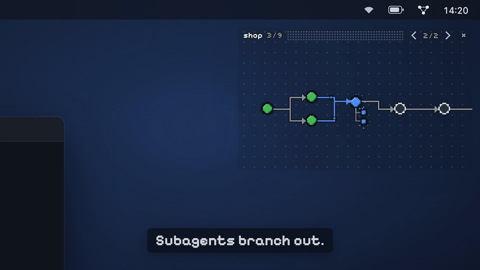
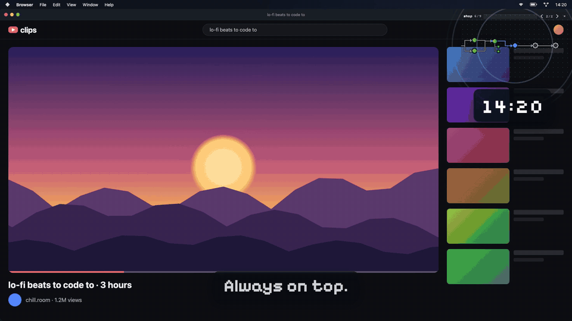
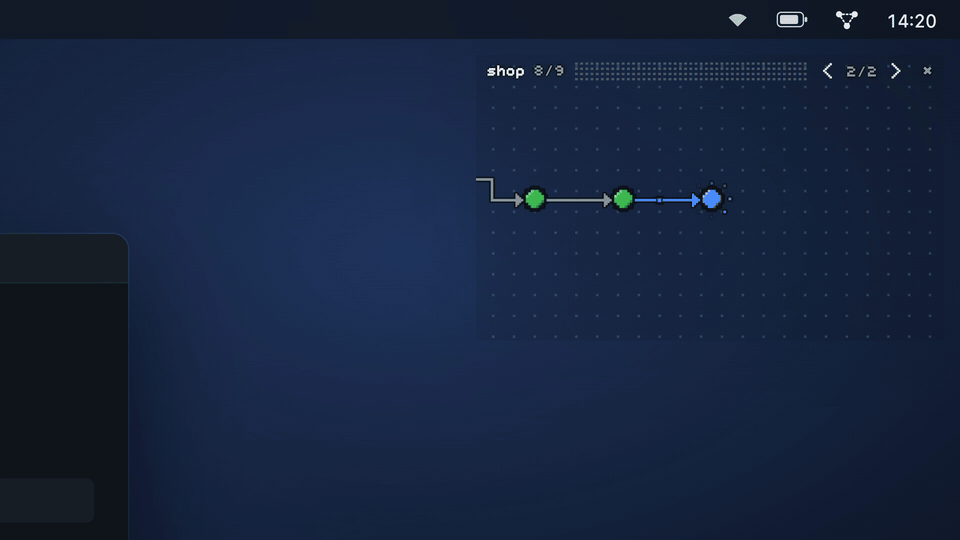
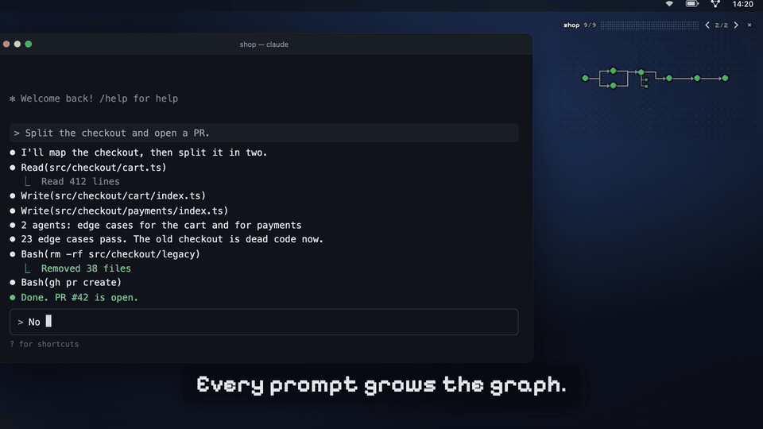
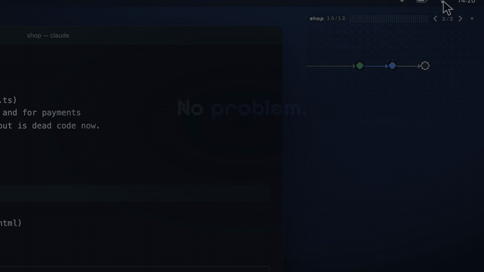
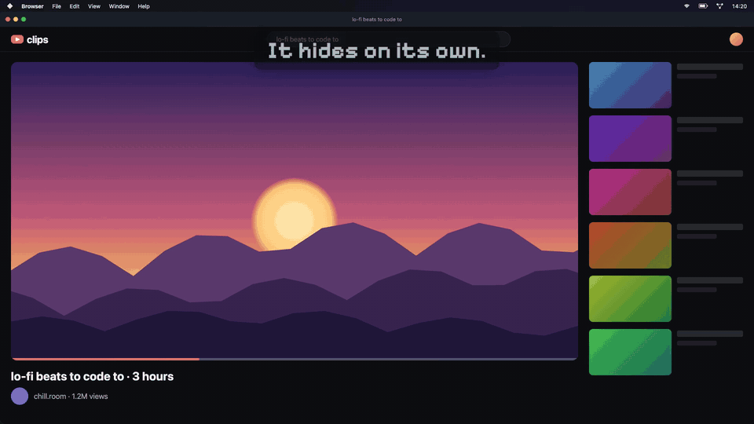

<h1 align="center">
  <picture>
    <source media="(prefers-color-scheme: dark)" srcset="docs/media/logo-dark.png">
    
  </picture>
</h1>

<p align="center">
  <b>English</b> · <a href="README.pt-BR.md">Português</a>
</p>

<p align="center">
  What Claude Code is doing, what comes next and when it needs you,<br>
  in a small floating window on your Mac or Windows PC.
</p>

<p align="center">
  <a href="https://flowctl.vercel.app"><b>Website</b></a> ·
  <a href="#install"><b>Install</b></a> ·
  <a href="#features"><b>Features</b></a> ·
  <a href="LICENSE"><b>MIT license</b></a>
</p>

<p align="center">
  
</p>

## Why

You ask Claude Code for something, then go do something else while it works.
You think it is working. But it may have stopped a while ago to ask you
something, and you only find out when you come back. And when it is working, a
long session is a wall of text: to know what it is doing, what is left and
whether it needs you, you have to scroll back and read. With a few sessions
open in different terminals, you end up checking each one in turn.

FlowCTL draws the session instead. The agent's plan becomes a graph: one node
per step, arrows for what depends on what, colors for where each step is. It
floats above your other windows, so a glance tells you how the work is going
and whether a session needs you, without leaving what you are doing.

| Color  | Meaning                                         |
| ------ | ----------------------------------------------- |
| white  | pending                                         |
| blue   | in progress                                     |
| yellow | needs you: a permission prompt or a question    |
| red    | failing: a tool error flashes it, repeated ones keep it red |
| green  | done                                            |
| faded, dashed | skipped: the turn ended without starting it (left out of the progress count) |

## Features

The clips come from the launch video, which adds captions and a few highlights
of its own (the rings around the window and the graph, the prompt labels);
everything else is the app as it runs.

### The plan as a graph

Steps the agent declares (Claude Code's task tools, or FlowCTL's own FlowPlan
tool) with their dependencies. Steps that run in parallel sit side by side.
Subagents hang from the step that started them, or line up as their own
timeline when the agent uses them without a plan. The camera follows the work
while a session runs and shows the whole graph when it rests; drag to pan,
pinch or scroll to zoom.

### Errors flash red

A tool error flashes its step red; repeated ones keep it red, so you see the
agent working around a problem, or stuck on one. Hover a node for what it is
about, how long it took and what came of it; click it to bring its terminal
tab forward.

<p align="center">
  
</p>

### Yellow means you

A permission prompt or a question turns its step yellow, the menu bar (or
tray) icon blinks, and a short sound plays. The window stays on top of
whatever you are doing, and one click takes you to the terminal that is
waiting.

<p align="center">
  
</p>

### Done? You'll know

The last step turns green and the turn ends: a glance at the window tells you
the work is done, with no scrolling back through the terminal.

<p align="center">
  
</p>

### Every prompt grows the graph

Each new request continues the same graph to the right, so a session reads as
one story. And every open session gets a page: `‹ 1/3 ›` switches between
them, and when the page on screen is resting, the window turns to the session
that starts working or needs you.

<p align="center">
  
</p>

### Make it yours

Everything is in the menu bar (or tray) icon: two looks (pixel art with 8-bit
sounds, or smooth with clean tones), sound or silence, theme, size, opacity,
and where the window sits: drag it anywhere.

<p align="center">
  
</p>

### Out of your way when you're not

After five minutes with nothing running, the window fades out until a session
works again (Hide When Idle). Before that, the idle animation kicks in: after a
minute, the nodes leave the graph and form a shape that turns slowly. Both are
on by default and can be turned off in the menu.

<p align="center">
  
</p>

## Install

Requirements: macOS 13 or later, or Windows 10 or 11 (64-bit), and Claude Code
2.1.295 or later. FlowCTL has
two parts, both installed from a Claude Code session:

```
/plugin install flowctl --marketplace MarcoFilho1/FlowCTL
/flowctl init
```

1. **The plugin.** The first line adds this repository as a plugin
   marketplace (answer `y`), then installs the plugin. Choose the **user**
   scope so it works in every project. The plugin watches the session and
   builds the graph.
2. **The overlay app.** `/flowctl init` downloads the app of the same version
   from this repository's GitHub Releases, checks its SHA-256 and signature,
   installs it (no admin password) and opens it: in `~/Applications` on a Mac,
   in `%LOCALAPPDATA%\Programs\FlowCTL` with a Start menu shortcut on
   Windows. The app is the floating window and the menu bar (or tray) icon.

## Day to day

**You install once.** You do not run either command again when you open a new
session:

- Every Claude Code session you start loads the plugin by itself.
- When a session starts, the plugin opens the overlay if it is not already
  running. Several sessions share one window, one page each.
- The window shows itself when a session starts working and fades out after
  five minutes with nothing running. Close it with **×** and it stays closed
  until you reopen it from the menu bar (or tray) icon.

**Sessions that were already open** when you installed the plugin: run
`/reload-plugins` in each to load it. The instruction that asks the agent to
declare a plan reaches it from the next session, so restart those sessions
with `claude --continue` to keep their conversation and get the plan too.

**When does the graph have more than one node?** When the agent declares a
plan. FlowCTL asks it to, for work of three or more steps; a quick question or
a one-command fix shows a single node for the current turn. You can turn that
request off in the plugin's options.

**Updating.** When a new version is out, update the plugin from `/plugin`
(or `claude plugin update flowctl@flowctl`), run `/reload-plugins`, and the
next session start tells you if the app is older than the plugin: run
`/flowctl init` again to update it.

## Commands and options

| Command | What it does |
| ------- | ------------ |
| `/flowctl init` | Installs or updates the overlay app to the plugin's version; opens it if it is already there |
| `/flowctl init --force` | Installs it again |
| `/flowctl init --from-source` | Builds it from the tagged source instead of downloading (macOS only; needs pnpm, Node 22 and Swift) |
| `/flowctl uninstall` | Quits and removes the app (the plugin is removed from `/plugin`) |

The **menu bar icon** (on Windows, the tray icon: left click shows or hides
the panel, right click opens the menu) holds the overlay's settings: show or hide the panel,
opacity, size (small, medium, large), look (pixel or smooth), theme (auto,
dark, light), sound, show subagents, idle animation, always on top, show
automatically, hide when idle.

The **plugin's options** (`/plugin`, then flowctl):

| Option | Default | |
| ------ | ------- | - |
| Open the overlay | on | Open the app when a session starts, if it is installed |
| Ask the agent to declare its plan | on | Without it, the graph is usually one node |
| Errors before red | 3 | Consecutive tool errors that turn the current step red |
| Record events | off | Keep the session's events in `~/.flowctl/recordings`, for bug reports |

## Privacy

Everything stays on your computer. The plugin hands the app each graph over a
local socket (`~/.flowctl/overlay.sock`; on Windows, `127.0.0.1` with a token
from `~/.flowctl/overlay.json`) and keeps the latest one per session in
`~/.flowctl/sessions`. A graph holds step titles, statuses and times, a short
summary of what a step or subagent answered, and the first line of a tool
error; never your prompts, file contents or full command output. Nothing is
sent anywhere: the only network call is `/flowctl init` downloading the app
from GitHub.

## How it works

```
Claude Code session ──hooks──▶ plugin (mod/) ──snapshot──▶ overlay app (apps/overlay*)
  tasks, subagents,             builds the graph,           a floating window drawing
  permission prompts            lays it out                 the graph (apps/viewer)
```

The plugin is a [Claude Code mod](https://code.claude.com/docs/en/plugins/mods/overview):
it observes the session's events (task tools, subagents, permission checks,
tool errors) and never changes what the agent does, apart from the optional
request to declare a plan. The app is a native panel (Swift on macOS, Tauri
on Windows) hosting a small web view; the graph is drawn by the viewer, a
React page bundled into the app.

## Roadmap

- **Linux.** The plugin, the viewer and the Windows app (Tauri) already run
  there; packaging it is next.
- Your ideas: open an issue.

## Develop

```
mod/             the Claude Code plugin
  hooks/         hooks module: register.ts
  graph/         graph logic, pure TypeScript with no imports
  live/          what the plugin shows and does: status line, rebuild, /flowctl
  tests/         plugin tests, run by `claude plugin test`
  types-vendor/  Claude Code's API types, versioned for CI
apps/viewer/     the graph, a React page (Vite, single file)
apps/overlay/    the macOS app (SwiftPM, no Xcode needed)
apps/overlay-tauri/  the Windows app (Tauri, Rust); see its README
tests/           unit tests for mod/, run by node --test
fixtures/        recorded sessions, replayed by the tests and the viewer
scripts/         install-overlay.sh builds and installs the app from source
docs/            roadmap, design notes and the README's media
```

Requires Node 22.6+, pnpm, Claude Code 2.1.295+ and, for the app, Swift (the
Command Line Tools are enough).

```sh
pnpm install
pnpm typecheck   # tsc over the plugin and the tests
pnpm test        # unit tests
pnpm validate    # claude plugin validate + claude plugin test
pnpm viewer:test # viewer tests

claude --plugin-dir ./mod              # a session with the plugin from this folder, hot-reloaded
pnpm viewer:dev                        # the viewer in a browser; ?fixture=all replays the recordings
scripts/install-overlay.sh --open      # build the app and install it
```

Don't run `--plugin-dir` alongside an installed copy of the plugin: the
session would load it twice.

**Releasing.** Set the same version in `mod/.claude-plugin/plugin.json`,
`MOD_VERSION` in `mod/live/install.ts`, `apps/overlay/Resources/Info.plist`,
and `apps/overlay-tauri/src-tauri/` (`tauri.conf.json` and `Cargo.toml`), then
push a tag `vX.Y.Z`. The Release workflow builds the macOS app for Apple
silicon and Intel and the Windows app for x64, and publishes
`FlowCTL-X.Y.Z-macos.zip` and `FlowCTL-X.Y.Z-windows-x64.zip` with their
SHA-256, which `/flowctl init` downloads. To try a build before tagging, serve a zip
and its `.sha256` under `<base>/vX.Y.Z/` and start the session with
`FLOWCTL_RELEASE_BASE=<base>`.

After a Claude Code upgrade, refresh `mod/types-vendor/claude-code.d.ts` from
`mod/.claude-plugin/types/claude-code/index.d.ts` (written each time a session
loads the mod) and bump `CLAUDE_CODE_VERSION` in CI.

## License

[MIT](LICENSE)
